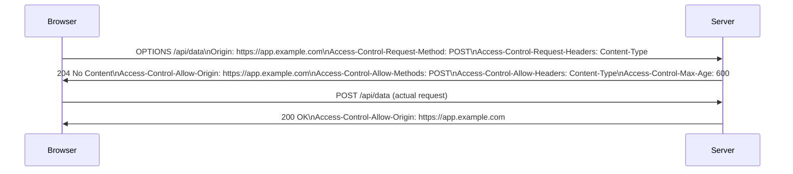

Cross-Origin Resource Sharing (CORS) is a browser security mechanism that controls which cross-origin requests a web page is allowed to make. The browser's Same-Origin Policy blocks requests to a different origin (scheme + host + port) by default; CORS is the controlled server-side opt-in to relax that.

CORS headers are read and enforced by browsers only. Server-to-server requests (curl, backend fetch) ignore CORS entirely — it is not a server access control.

---

## Simple vs Preflighted Requests

The browser treats a request as **simple** (no preflight) only if it meets all of:
- Method is `GET`, `POST`, or `HEAD`
- Content-Type is `application/x-www-form-urlencoded`, `multipart/form-data`, or `text/plain`
- No custom headers

Everything else — including `application/json` bodies, `Authorization` headers, `PUT`/`PATCH`/`DELETE` — triggers a **preflight**.

### Preflight flow



If the preflight fails or is missing, the browser blocks the actual request and the developer sees a CORS error in the console — not a network error from the server.

---

## Response Headers

| Header | Purpose |
|---|---|
| `Access-Control-Allow-Origin` | Which origin(s) may read the response |
| `Access-Control-Allow-Methods` | Allowed HTTP verbs for preflighted requests |
| `Access-Control-Allow-Headers` | Allowed request headers for preflighted requests |
| `Access-Control-Allow-Credentials` | Whether the browser may send cookies / `Authorization` headers |
| `Access-Control-Expose-Headers` | Response headers the browser makes available to JS (beyond the safe defaults) |
| `Access-Control-Max-Age` | Seconds the browser may cache the preflight result |
| `Vary: Origin` | Tells CDNs the response differs by origin — required when using per-origin allowlists |

**`Access-Control-Max-Age` practical limits:** Chrome caps at 7,200s (2h), Firefox at 86,400s (24h). A value of `600` (10 min) is a sensible default — short enough to allow config changes, long enough to reduce preflight overhead.

---

## Credentialed Requests

By default, cross-origin requests do not include cookies or `Authorization` headers. To include them, both sides must explicitly opt in:

**Client (fetch):**
```js
fetch('https://api.example.com/data', {
  credentials: 'include',  // send cookies and auth headers
})
```

**Server response must include both:**
```http
Access-Control-Allow-Origin: https://app.example.com
Access-Control-Allow-Credentials: true
```

The wildcard `Access-Control-Allow-Origin: *` is **rejected by browsers** when `Access-Control-Allow-Credentials: true` is also set. This is intentional — allowing any origin to read credentialed responses would let any website silently read your cookies on any other site.

---

## Correct Configuration

### Single trusted origin
```http
Access-Control-Allow-Origin: https://app.example.com
Access-Control-Allow-Methods: GET, POST, PUT, DELETE
Access-Control-Allow-Headers: Content-Type, Authorization
Access-Control-Max-Age: 600
```

### Dynamic allowlist (multiple origins)

Reflect the `Origin` header back **only if it is in your allowlist**, and always add `Vary: Origin`. Without `Vary: Origin`, a CDN may cache a response containing one origin's header and serve it to a different origin.

```python
ALLOWED_ORIGINS = {"https://app.example.com", "https://admin.example.com"}

def add_cors_headers(request, response):
    origin = request.headers.get("Origin")
    if origin in ALLOWED_ORIGINS:
        response.headers["Access-Control-Allow-Origin"] = origin
        response.headers["Vary"] = "Origin"
```

---

## Common Misconfigurations

### Blind origin reflection
```python
# Dangerous — allows any origin including https://evil.com
response.headers["Access-Control-Allow-Origin"] = request.headers["Origin"]
```
Fix: check against an explicit allowlist before reflecting.

### Wildcard with credentials
```http
Access-Control-Allow-Origin: *
Access-Control-Allow-Credentials: true
```
Browsers block this combination. If you need credentials, you must name a specific origin.

### Missing `Vary: Origin` on cached responses
If your CDN or reverse proxy caches responses, a response with `Access-Control-Allow-Origin: https://app.example.com` will be served to all origins unless `Vary: Origin` tells the cache to key on origin. The second origin gets the first origin's CORS headers — and the request fails.

### Overly broad methods/headers in production
```http
Access-Control-Allow-Methods: *
Access-Control-Allow-Headers: *
```
Wildcards for methods and headers are supported in modern browsers but increase attack surface. Enumerate only what your API actually uses.

---

## When NOT to Relax CORS

- **Internal APIs not called from a browser** — CORS config has no effect; focus on network-level access controls instead
- **When you can proxy through your own origin** — a `/api/proxy` route on your own domain avoids cross-origin entirely and is simpler than maintaining a CORS allowlist
- **Public read-only CDN assets** — `Access-Control-Allow-Origin: *` is fine here; the risk only arises with credentialed or mutating requests
