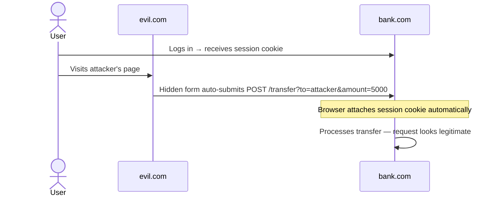

Cross-Site Request Forgery (CSRF) tricks an authenticated user's browser into sending a request to a site they're already logged into — without their knowledge. Because browsers automatically attach cookies to matching requests, the server receives what looks like a legitimate, authenticated request.

---

## How It Works



The attacker never sees the cookie. They don't need to — the browser sends it on their behalf.

### What makes a request exploitable

The attack works when all three are true:

1. The endpoint authenticates via cookies (or other browser-auto-sent credentials)
2. The endpoint performs a state-changing action
3. No unpredictable request parameter is required

---

## Login CSRF

CSRF isn't limited to authenticated actions. An attacker can forge a *login* request to log the victim into the attacker's account:

```html
<form action="https://target.com/login" method="POST">
  <input name="username" value="attacker@evil.com">
  <input name="password" value="attacker_password">
</form>
<script>document.forms[0].submit()</script>
```

The victim is now logged into the attacker's account. If they enter payment details, personal data, or messages — the attacker can retrieve them later. Always apply CSRF protection to login endpoints, not just authenticated actions.

---

## Defences

### 1. SameSite Cookies

Controls whether the browser sends a cookie on cross-site requests. Set on the cookie itself:

| Value | Behaviour |
|---|---|
| `Strict` | Cookie never sent on any cross-site request, including top-level navigations (clicking a link from another site) |
| `Lax` | Cookie sent on top-level navigations (GET link clicks) but blocked on cross-site subrequests (forms, fetch, XHR). **Browser default since Chrome 80 / Firefox 79** |
| `None` | Cookie sent on all cross-site requests. Requires `Secure` flag |

`SameSite=Lax` is now the default in modern browsers and blocks the classic CSRF form-post attack. However, `Lax` still allows cookies on cross-site GET navigations — if any GET endpoint mutates state, Lax is not sufficient; use `Strict`.

```http
Set-Cookie: session=abc123; SameSite=Lax; Secure; HttpOnly
```

`SameSite` alone is not sufficient if you need to support older browsers or embed your service in cross-origin iframes.

### 2. CSRF Tokens (Synchroniser Token Pattern)

Server generates a random, unpredictable token per session (or per request). The token is embedded in every state-changing form and validated server-side before processing.

```html
<form method="POST" action="/transfer">
  <input type="hidden" name="csrf_token" value="a3f8c2...">
  ...
</form>
```

Server validation:
```python
if request.form['csrf_token'] != session['csrf_token']:
    abort(403)
```

The attacker cannot read the token from another origin (Same-Origin Policy blocks cross-origin reads), so they cannot forge a valid request. This is the strongest general-purpose defence.

**Framework defaults:** Django (`CsrfViewMiddleware`), Rails (`protect_from_forgery`), and Spring Security all enable this by default. A common mistake is disabling CSRF middleware for "API views" and then adding cookie-based session auth to those same views — the exemption removes the protection at exactly the point it's needed.

### 3. Double Submit Cookie

Send the CSRF token in both a cookie and a request parameter. Server checks they match, without storing state server-side.

```
Cookie: csrf_token=abc123
Body:   csrf_token=abc123
```

Since the attacker cannot read cookies from another origin, they cannot replicate the value in the request body.

**Caveat:** only as secure as your cookie isolation. If there's a subdomain takeover (`https://sub.yourdomain.com` controlled by an attacker) or an XSS vulnerability anywhere on your domain, the attacker can set the cookie and forge the matching request body. Weaker than server-stored tokens.

### 4. Custom Request Headers

Requiring a custom header (e.g. `X-Requested-With: XMLHttpRequest`) forces a CORS preflight for cross-origin requests. If your CORS policy doesn't allow the attacking origin, the preflight fails and the request is blocked.

This is why **JSON APIs using `Authorization` headers are naturally resistant to CSRF** — `Authorization` is a custom header that triggers a preflight. The immunity comes from CORS enforcement, not from any inherent property of the header itself.

**Critical caveat:** this breaks down if your CORS policy is misconfigured. `Access-Control-Allow-Origin: *` with allowed credentials, or a wildcard that includes the attacker's origin, removes this protection entirely. See [[cors]].

Also: if your endpoint accepts both `application/x-www-form-urlencoded` (a simple content type, no preflight) and `application/json`, the form-based path bypasses the preflight and reintroduces the vulnerability.

### 5. Origin / Referer Header Checking

Check that the `Origin` or `Referer` header matches your expected domain before processing a request.

```python
origin = request.headers.get('Origin')
if origin and origin != 'https://yourdomain.com':
    abort(403)
```

**Caveats:**
- `Referer` can be suppressed by browser privacy settings, extensions, or corporate proxies — a missing header must be allowed or legitimate users are blocked
- `Origin` is more reliable but may be absent on same-origin requests in some contexts
- Neither should be the primary defence — use as a supplementary check alongside tokens or SameSite cookies

---

## Choosing a Defence

| Scenario | Recommended Defence |
|---|---|
| Server-rendered forms (Django, Rails) | CSRF tokens (framework default) + `SameSite=Lax` |
| SPA with cookie-based auth | `SameSite=Strict` + CSRF token in custom header |
| API with `Authorization` header (JWT, API key) | No cookies = no CSRF; ensure CORS is correctly configured |
| API that also supports cookie auth | Treat as cookie-based — apply CSRF tokens |
| Login / logout endpoints | Always protect — login CSRF is a real attack vector |

---

## When CSRF Doesn't Apply

- **Requests authenticated only via `Authorization` header or API key** — these require custom headers, which trigger CORS preflights. Not immune if CORS is misconfigured.
- **Actions with no side effects** — but be precise: "no side effects" means the server state doesn't change, not just that the method is GET. A GET that logs, charges, or modifies anything is in scope.
- **Mobile apps making direct API calls** — native apps don't use the browser cookie jar, so the browser-auto-send mechanism doesn't apply. Standard auth (JWT, API key) is sufficient.
