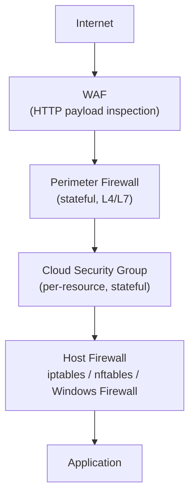

A firewall inspects network traffic and allows or denies it based on rules. The fundamental design principle is **default-deny**: block everything, then explicitly allow only what is needed. Any rule that opens traffic should have a specific justification.

---

## Types of Firewall

### Packet Filtering (L3/L4)

Inspects IP addresses and port numbers only. Stateless — it has no memory of previous packets, so each packet is evaluated in isolation.

Because it's stateless, return traffic is not automatically permitted. To allow a client to receive a response on an outbound connection, you must explicitly allow the return direction too — or use a stateful firewall instead.

**Use for:** simple, high-throughput network boundary rules where performance matters more than depth of inspection.

### Stateful Inspection (L4)

Tracks the state of TCP/UDP connections. Once an outbound connection is established, return traffic is automatically allowed without a separate rule.

```
Client → Server: SYN       → firewall records connection state
Server → Client: SYN-ACK   → allowed automatically (matches tracked state)
Client → Server: ACK        → allowed automatically
```

This is the standard for most perimeter and cloud firewalls. Rules focus on who initiates connections rather than managing both directions.

### Next-Generation Firewall — NGFW (L7)

Operates at the application layer. Can identify applications by behaviour regardless of port — Slack, Zoom, and a custom HTTPS app all use port 443, but an NGFW can tell them apart. Combines:

- Stateful inspection
- Deep packet inspection (DPI) — reads packet payloads
- Intrusion Detection/Prevention (IDS/IPS) — detects and blocks known attack patterns
- Application identity — allow/deny by app, not just port

**Use for:** corporate networks, regulated environments, anywhere you need visibility into what applications are running on the network, not just what ports.

### Web Application Firewall — WAF (L7 HTTP)

A WAF inspects HTTP/S traffic specifically. Where a network firewall controls *who* can connect, a WAF controls *what requests* are allowed through.

| Threat | WAF Can Block |
|---|---|
| SQL injection | Yes — detects injection patterns in parameters |
| XSS | Yes — detects script payloads |
| CSRF | Partial — requires token validation logic |
| DDoS / rate abuse | Yes — rate limiting and bot detection |
| Path traversal | Yes — detects `../` patterns |

WAFs work on rules (OWASP Core Rule Set) and/or machine learning models. They generate false positives — tune rules before enabling block mode.

---

## Ingress vs Egress

Most firewall configs focus on inbound (ingress) traffic. Egress filtering is equally important and often neglected.

**Ingress:** controls what can reach your services
**Egress:** controls what your services can reach outbound

Egress filtering limits the blast radius of a compromise:
- A breached server cannot phone home to a C2 server
- Exfiltration of data over unexpected ports is blocked
- Limits lateral movement to internal services

```
# Typical egress allowlist for an app server
Allow: 443 → package repos, APIs your app calls
Allow: 5432 → your database subnet only
Deny: everything else outbound
```

---

## Layered Defence

No single firewall covers all threat classes. The standard stack:



Each layer catches a different class of threat. A misconfigured security group doesn't expose you if the perimeter firewall is correct — and vice versa.

---

## Cloud Firewalls (AWS)

### Security Groups

- Stateful — return traffic is automatically allowed
- Applied per resource (EC2, RDS, Lambda, etc.)
- Rules specify protocol, port range, and source (CIDR or another security group)
- Default: deny all inbound, allow all outbound

```
# App server security group
Inbound:  443 from 0.0.0.0/0        ← public HTTPS
Inbound:  22  from bastion-sg        ← SSH from bastion only
Outbound: 5432 to database-sg        ← PostgreSQL to DB tier
Outbound: 443 to 0.0.0.0/0          ← outbound HTTPS (APIs, packages)
```

Referencing another security group as a source (e.g. `database-sg → app-sg`) is more robust than a CIDR range — it stays correct as IPs change.

### Network ACLs

- Stateless — you must explicitly allow both inbound and outbound for each flow
- Applied per subnet, evaluated before security groups
- Rules evaluated in order by rule number; first match wins
- Default VPC NACL: allow all traffic in both directions

```
# NACL rules for a private database subnet
100  ALLOW TCP  10.0.1.0/24  5432        INBOUND   ← from app subnet
110  ALLOW TCP  10.0.1.0/24  1024-65535  OUTBOUND  ← ephemeral return ports
*    DENY  ALL  0.0.0.0/0               ← default deny
```

The ephemeral port range (1024–65535) must be explicitly allowed outbound on NACLs — a common mistake that breaks connections that work fine with security groups alone.

### Security Group vs NACL

| | Security Group | Network ACL |
|---|---|---|
| Statefulness | Stateful | Stateless |
| Scope | Per resource | Per subnet |
| Rule evaluation | All rules evaluated | First match wins |
| Default (custom) | Deny all inbound | Deny all (if customised) |
| Return traffic | Auto-allowed | Must be explicit |

---

## Common Misconfigurations

**0.0.0.0/0 on sensitive ports** — databases, admin panels, and internal services should never be reachable from the public internet. Scope source CIDRs to your VPC or app subnet.

**Allowing all outbound (`0.0.0.0/0`)** — the AWS default. Fine for development; tighten for production to limit exfiltration surface.

**IP allowlisting as a security boundary** — shared SaaS vendors often egress from a pool of IPs used by all their customers. Allowlisting `52.x.x.x` because your vendor uses it also lets every other customer of that vendor reach you. Use authenticated connections, not IP trust.

**Forgetting ephemeral ports on NACLs** — TCP responses use ephemeral source ports (1024–65535). Stateless NACLs require these to be explicitly allowed outbound. Security groups handle this automatically.

**No host-based firewall** — perimeter firewalls protect the network boundary, not east-west traffic between services in the same subnet. Host-based firewalls (iptables, nftables) or service mesh mTLS catch lateral movement that bypasses the perimeter.

---

## When Firewalls Don't Help

- **Application-layer attacks over allowed ports** — a firewall permitting port 443 passes a valid HTTPS request carrying a SQL injection payload. That's the WAF's job, not the network firewall's.
- **Compromised credentials** — a legitimate user authenticating with stolen credentials passes firewall rules cleanly. Firewalls enforce network access, not identity.
- **Encrypted C2 traffic over allowed ports** — malware calling home over HTTPS port 443 passes a port-based rule. NGFW with DPI or DNS monitoring is needed to detect this.
