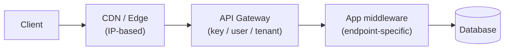

Rate limiting caps how many requests a client can make in a time window. It protects services from abuse, accidental overload, and noisy-neighbour effects in multi-tenant systems.

## Algorithms

### Token Bucket

A bucket holds up to `capacity` tokens and refills at a fixed `rate`. Each request consumes one token; requests are rejected when the bucket is empty.

```
capacity:    100 tokens   ← max burst size
refill rate: 10 tokens/s  ← sustained throughput limit

Burst of 100 → all allowed (empties bucket)
101st request → rejected until tokens refill (10s for full recovery)
```

The refill rate — not the capacity — is the sustained limit. Capacity controls how large a burst you permit.

**Best for:** APIs that want to allow short bursts but enforce a sustained average. Most CDNs and cloud providers use this.

### Fixed Window Counter

Count requests per fixed time window (e.g. 1-minute slots). Reset the counter at the window boundary.

```
Window 00:00–01:00 → 500 requests
Window 01:00–02:00 → counter resets to 0
```

**Boundary burst problem:** 500 requests at 00:59 + 500 requests at 01:01 = 1,000 requests in 2 seconds, yet both windows show 500. Simple but exploitable.

### Sliding Window Log

Store a timestamp for every request. On each new request, discard entries older than the window and count what remains.

- Precise — no boundary burst problem
- Memory cost scales with request volume, not just window size — impractical at high throughput

### Sliding Window Counter

Approximation using two fixed-window counters (current + previous):

```
rate ≈ prev_count × (1 - elapsed/window) + curr_count
```

Assumes the previous window's traffic was uniformly distributed — the error is at most a few percent in practice. Good balance of accuracy and memory cost.

### Leaky Bucket

Requests enter a fixed-size queue and drain at a constant rate. Requests that arrive when the queue is full are dropped.

Unlike token bucket, leaky bucket smooths output — it cannot burst even if the queue is empty. Use it when the downstream system has a hard per-second cap (e.g. a third-party API), not when you want to permit bursts.

---

## Algorithm Comparison

| Algorithm | Burst allowed | Memory | Accuracy | Complexity |
|---|---|---|---|---|
| Token bucket | Yes (up to capacity) | Low | High | Low |
| Fixed window | Yes (at boundary) | Very low | Medium | Very low |
| Sliding window log | No | High | Exact | Medium |
| Sliding window counter | Partial | Low | ~99% | Low |
| Leaky bucket | No | Medium | High | Low |

---

## Where to Enforce



| Layer | Scope | Example |
|---|---|---|
| CDN / Edge | IP-based, DDoS protection | Cloudflare, AWS Shield |
| API Gateway | API key, user, or tenant | Kong, AWS API Gateway |
| Application | Per-endpoint logic | Middleware in Express / FastAPI |

Enforce coarse limits at the edge and fine-grained limits closer to the application. Don't rely on a single layer — each can be bypassed or saturated independently.

---

## HTTP Contract

A rate-limited response must return `429 Too Many Requests`. Include response headers so clients can back off correctly rather than immediately retrying:

```http
HTTP/1.1 429 Too Many Requests
X-RateLimit-Limit: 1000
X-RateLimit-Remaining: 0
X-RateLimit-Reset: 1718620800
Retry-After: 60
Content-Type: application/json

{"error": "rate_limit_exceeded", "retry_after_seconds": 60}
```

| Header | Meaning |
|---|---|
| `X-RateLimit-Limit` | Max requests allowed in the window |
| `X-RateLimit-Remaining` | Requests left in current window |
| `X-RateLimit-Reset` | Unix timestamp when the window resets |
| `Retry-After` | Seconds until the client may retry (also accepted as HTTP date) |

Omitting `Retry-After` causes well-behaved clients to retry immediately, making the overload worse.

---

## Distributed Rate Limiting

A per-process counter breaks the moment you scale horizontally — each instance sees only its own slice of traffic. You need shared state.

**Redis is the standard choice** for single-region deployments. For Redis Cluster or multi-region, reads from replicas can be stale; use `WAIT` or a single primary shard for the counter if accuracy matters more than availability.

**Atomic increment with TTL (Lua script):**

```lua
local count = redis.call("INCR", KEYS[1])
if count == 1 then
  redis.call("EXPIRE", KEYS[1], ARGV[1])
end
return count
```

Call with: `KEYS[1] = "rl:user:42:min:202606171432"`, `ARGV[1] = 60`

The key encodes the granularity — include the minute (or hour) in the key, not just the user ID. A key of `rl:user:42` with a fixed TTL creates a sliding window; a key that includes the time bucket creates a fixed window.

**Why atomicity matters:**

```
Process A reads count=99  (limit=100)
Process B reads count=99
Process A writes count=100 → allowed ✓
Process B writes count=100 → allowed ✓  ← limit bypassed
```

A non-atomic read-then-write races under concurrent load.

**When Redis is unavailable:** decide in advance whether to fail open (allow all requests) or fail closed (block all requests). Failing open is safer for availability; failing closed is safer against abuse. Failing open with an alert is the common default.

---

## Identifying Callers

| Key | Use when |
|---|---|
| IP address | Unauthenticated endpoints, DDoS protection |
| API key | Per-consumer limits on public APIs |
| User ID | Authenticated endpoints |
| Tenant ID | Multi-tenant SaaS — limit per org, not per user |
| Endpoint + user | Different limits per route (`/search` vs `/upload`) |

IP-based limits are blunt: a shared office or carrier-grade NAT puts many users behind one IP, so one bad actor can trigger limits for everyone. Use IP limits as a first defence layer, not as your primary control.

---

## When NOT to Use Rate Limiting

- **Internal service-to-service calls** where you control both sides — backpressure (queue depth signals) or circuit breakers are better fits
- **Batch / async ingestion** — rate limiting queued work adds latency without protecting anything; throttle at ingestion or use a work queue with concurrency limits instead
- **As a substitute for authentication** — rate limits slow attackers, they don't stop them; authenticate and authorise first

---

## Common Pitfalls

- **Shared limits across endpoints** — a `/search` flood should not block `/checkout`; set limits per route or resource type
- **No `Retry-After` header** — clients retry immediately, amplifying load rather than reducing it
- **Clock skew in distributed systems** — fixed-window keys based on wall time must use Redis server time (`TIME` command), not application server time
- **Forgetting service accounts** — internal callers and monitoring systems hit the same limits as external users unless explicitly excluded or given separate, higher quotas
