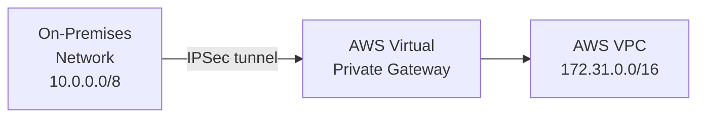

A VPN (Virtual Private Network) creates an encrypted tunnel between two endpoints. Traffic inside the tunnel is protected from the local network and ISP. The two primary uses are different enough to treat separately: remote access for individual users, and site-to-site links between networks.

---

## Remote Access VPN

Individual clients connect to a VPN gateway to reach internal resources. The gateway authenticates the user and places them on the internal network.

### Full tunnel vs split tunnel

**Full tunnel** — all client traffic routes through the VPN, including general internet browsing. The corporate network sees and can inspect everything.

**Split tunnel** — only traffic destined for internal CIDRs routes through the VPN; internet traffic goes directly from the client.

| | Full Tunnel | Split Tunnel |
|---|---|---|
| Performance | Higher latency (all traffic backhauled) | Better (internet traffic is direct) |
| Visibility | Corporate sees all traffic | Corporate sees only internal traffic |
| Security risk | Lower (internet traffic filtered centrally) | Higher — see below |

**Split tunnel security risk:** a compromised endpoint can simultaneously communicate with the VPN and with attacker infrastructure over the direct internet path. The attacker can use the client as a pivot point into the internal network while the VPN gateway sees nothing suspicious.

---

## Site-to-Site VPN

Permanently connects two networks — typically an on-premises data centre to a cloud VPC. No client software needed; the tunnel is established between two gateways.

AWS setup: Customer Gateway (your end) + Virtual Private Gateway (AWS end) + VPN Connection. BGP is used to exchange routes dynamically; static routes are also supported but harder to maintain.

**Alternative for high throughput:** AWS Direct Connect provides a dedicated physical link rather than an encrypted internet tunnel — lower latency, consistent bandwidth, but higher cost and longer lead time.

---

## Protocols

### WireGuard

Modern protocol with a small codebase (~4,000 lines vs OpenVPN's ~70,000+). Faster handshakes, better performance, and a smaller attack surface.

**Tradeoff:** uses static public/private key pairs — no built-in user authentication or certificate authority. Key rotation is a manual operational concern. A departed employee's key must be explicitly removed from every peer config; there is no central revocation.

### OpenVPN

Mature, widely supported, runs over TCP or UDP. Certificate-based authentication via an internal CA. Supports MFA integrations. Larger codebase = larger attack surface, but the operational model (cert revocation, CRL) is well understood.

### IPSec / IKEv2

Standard for site-to-site and native on mobile OS (iOS, Android support IKEv2 natively). Certificate or pre-shared key authentication. `IKEv2` + `EAP` supports username/password and MFA. Common choice for enterprise remote access when native OS integration matters.

### Clientless SSL VPN

Browser-based, no client install required. Historically appealing for contractors or BYOD. However, clientless SSL VPN appliances (Citrix ADC, Pulse Secure, Palo Alto GlobalProtect) have been repeatedly exploited — CVE-2019-19781, CVE-2021-22893, CVE-2023-4966 among others. The "no client" convenience comes with a significantly larger attack surface exposed directly to the internet.

### Protocol Comparison

| Protocol | Best For | Auth Model | Attack Surface |
|---|---|---|---|
| WireGuard | Performance-sensitive, dev/infra teams | Static keys | Very small |
| OpenVPN | Flexible enterprise remote access | PKI / certificates | Medium |
| IPSec/IKEv2 | Site-to-site, native mobile clients | Certificates / EAP | Medium |
| Clientless SSL | Legacy BYOD (use with caution) | Password / SSO | Large |

---

## Key and Certificate Management

This is the most neglected part of VPN operations.

**WireGuard:** each peer has a public/private keypair. Public keys are listed in each peer's config. When an employee leaves, their public key must be removed from every gateway and peer config. There is no central revocation mechanism.

**OpenVPN / IPSec:** uses a Certificate Authority. Revoked certificates go on a Certificate Revocation List (CRL) or are checked via OCSP. All gateways must regularly fetch the updated CRL — a stale CRL means revoked certificates are still accepted.

Key rotation schedule matters: long-lived static keys are a liability if a device is lost or an employee leaves. Automate rotation where possible.

---

## VPN vs Zero-Trust Network Access (ZTNA)

Traditional VPNs grant broad network access — once a user authenticates, they are "on the network" and can reach anything not explicitly blocked. This is a large blast radius if credentials are compromised.

ZTNA grants access per-application rather than per-network:

| | VPN | ZTNA |
|---|---|---|
| Access model | Network-level (broad) | Application-level (narrow) |
| Implicit trust | Yes — once authenticated, broad access | No — every request evaluated |
| Lateral movement risk | High | Low |
| User experience | Client + tunnel overhead | Often transparent / per-app |
| Examples | OpenVPN, WireGuard, Cisco AnyConnect | Cloudflare Access, Zscaler, Google BeyondCorp |

ZTNA does not replace VPNs for all cases — site-to-site connectivity between networks still typically uses IPSec tunnels. But for remote employee access to internal applications, ZTNA is increasingly the better model.

---

## When VPNs Don't Help

- **Application-layer authentication** — a VPN gets a user onto the network; it doesn't authenticate them to individual applications. Apps still need their own auth.
- **Insider threats** — a legitimate user on the VPN with broad network access can reach resources they shouldn't. Network segmentation and least-privilege access at the application layer are needed regardless.
- **Privacy from the VPN provider** — traffic is hidden from the local network and ISP, but the VPN gateway sees it instead. For corporate VPNs this is expected; for commercial privacy VPNs you are trusting the provider's logging and jurisdiction claims.
- **Performance-sensitive real-time traffic** — VPN tunnelling adds latency and CPU overhead (encryption). Latency-sensitive workloads (VoIP, video conferencing) often perform better with split tunnelling or direct connections.
